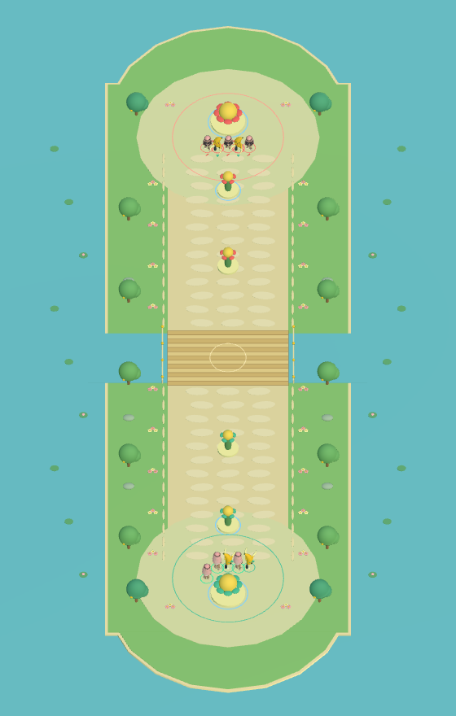

# 花溪大乱斗

v0.6.0，2026-10-17。原创建模的明亮单路地图与推核心模式；保留现有角色、朝向施法和键盘 / Xbox 操作。

## 进入与规则

- 选英雄进入练习后，按 **N / Xbox 十字键上**直接开始。也可在暂停菜单把“模式”切为花溪大乱斗，再选择“重新开始所选模式”。F / View 返回练习；Enter / A 可在结算后重开所选模式。
- **5 对 5**：一名真人和四名 AI 对抗五名 AI，香蕉刺客 / 越越大王可重复出现。这不等同于十人联网或五人本地输入；本地多人仍是后续工作。
- 双方各有外侧花灵守卫、内侧花灵守卫和花心核心。必须依次推进；外塔尚在时内塔 / 核心免伤，内塔尚在时核心免伤。敌方核心被摧毁获胜，己方核心被摧毁失败。
- 每座守卫 900 生命，核心 1800 生命。没有进攻方花灵在建筑八单位内支援时，建筑减伤 80%；有花灵支援时正常受伤。建筑免疫束缚、眩晕和击退，不成为越越大王的亡魂记录。
- 首批花灵在开局两秒后出发，此后每 12 秒一波、双方各三名；每方最多 18 名存活花灵。花灵 45 生命、基础攻击 7、移速 2.65，会推进并攻击敌方角色 / 花灵 / 已解锁建筑。
- 守卫攻击范围七单位、每 1.05 秒发射一枚可见花种，伤害 22。优先敌方花灵，再选择英雄 / 召唤物，鼓励跟随兵线推进。虚无可以免去花种接触伤害。
- 英雄阵亡不直接结束比赛，八秒后在己方基地复活，保留仍在进行的技能冷却、魂印和击败记录；取消未完成攻击及蓄力，清除控制，获得 1.5 秒出生免伤。己方出生区域每秒回复 12 点生命。花灵、建筑和短期亡魂不复活。
- 两位角色保留原技能。越越大王可从真实敌方英雄及花灵获得魂印、召回最近击败的外形 / 半属性基础攻击；H / 十字键左充能仍仅限练习，比赛中无效。

没有装备、经济、等级、匹配、随机英雄池、雪地地形、商店、网络或新的人类玩家输入。这是独立的单路推核心玩法，参考同类模式的结构，不使用其他游戏的地图 / 角色 / 音效资源。

## 地图与界面

狭长的花园岛屿由浅蓝湖水包围，奶油色步道贯穿两端花心庭院，中央木桥跨过小溪。圆冠果树、粉黄花丛、圆润石子、荷叶和荷花放在步道之外。守卫是带笑脸的花朵植物，阵营用薄荷绿和蜜桃红区分。

地图在 Z 轴方向行走范围为 -34～34；中央通路 X 为 -6～6，基地逐渐展开至 -9～9。采用平面边界约束，装饰不是实心障碍；没有隐蔽的物理台阶或寻路墙。技能位移、击退、香蕉皮和召唤出生点统一经过当前地图的边界接口，避免被旧花园圆形边界拉回。

游戏镜头沿角色纵向跟随，保留向前视野；小地图显示双方英雄、花灵、建筑与真人标记。左上方显示两座守卫状态 / 核心生命，顶部显示英雄击败与时间，死亡期间显示复活倒计时。全图预览是诊断录制视角，正常游玩采用跟随镜头。

## 实现与交接

- `Visuals/FlowerLaneMap.cs`：固定种子的原创地图、灯光、花溪木桥和地图边界。
- `Modes/LaneIntegration.cs`：独立模式选择 / 激活状态、地图启停、共用移动边界与可选目标过滤。练习 / 三波挑战保留原圆形地图。
- `Modes/LaneMatch.cs`：队伍、英雄出生 / 复活、兵线、核心目标链、比赛清理。比赛结束立即停止 AI 与出兵；退出模式停用旧对象，避免帧末 Destroy 期间残留伤害。
- `Modes/LaneHeroBot.cs`：复用真实英雄技能接口，推进 / 选敌 / 低血撤退，香蕉连招、突刺、陷阱与旋转，越越大王骷髅 / 铁索 / 召唤 / 鬼影 / 蓄力大招。投射物和伤害沿用真实玩法结算。
- `Modes/LaneMinion.cs`、`LaneStructure.cs`：花灵 AI、建筑保护、支援减伤、目标优先级、花种弹体。共用阵营过滤、控制及伤害入口，不另造一套伤害系统。
- `BananaPlayer.SetupTeam / RespawnAt` 提供两队控制器初始化与非重开式复活；越越大王覆写瞬态清理，保留大招资源 / 冷却。`GameRoot.ClearSession` 仍负责彻底清空一局。
- 同一张地图几何延迟创建并缓存，切换时停用；双方角色复用皮肤 / 材质和现有程序动作。数量上限是保护措施，不代表已经验证五个独立本地视口的性能。

常规验收：`Tools/Build.ps1`、`Tools/Smoke.ps1`、`Tools/CheckSource.ps1`。`LaneChecks` 覆盖长地图边界、跟随镜头、兵线推进、花种实际命中、目标优先级、建筑保护 / 减伤、两队复活、冷却保留、核心胜负和切回旧模式。

`Tools/LaneSimulation.ps1` 为加速 AI 对局工具：使用真实玩家控制器和九名 AI，关闭绘制并采用固定 0.1 秒模拟步长；用于检测推进 / 胜负流程，不能当作手动游玩、实时性能或真实硬件验收。`Tools/PreviewLane.ps1` 单独录制正常绘制、正常时钟的实际 AI 演示，把主控越越大王交给同一 AI，从正常基地出发。

后续优先事项：人工试玩调整两类英雄重复阵容的平衡、对长时间僵局的兵线节奏调优，以及目标机器上多人视口的性能测量。真实手柄、电视与多人输入验收需单独记录。

当前角色 / 建筑采用平面位置与战斗距离判定，尚未加入实体阻挡或复杂绕行。两类英雄会重复出场，AI 阵容并不等同于完整英雄池；测试能结束比赛，不代表已完成竞技平衡。
