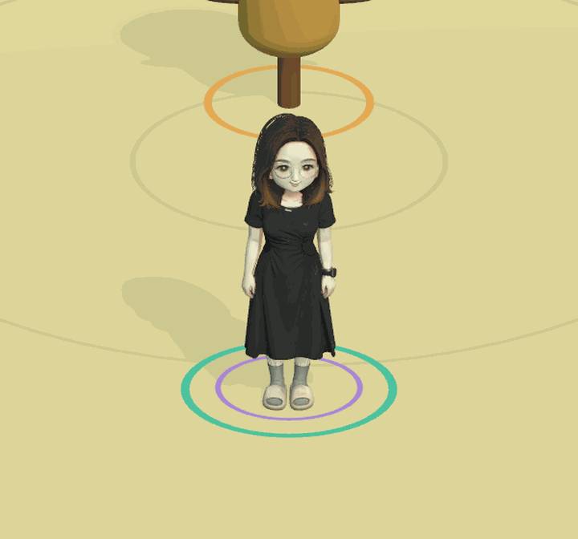

# 女巫 · 模型与基础动作预览（v0.11.0）

用户本轮只确定角色名和模型，普攻 / 技能等待后续设计。角色选择新增第三张「女巫」卡片，确认后进入花园外观预览；WASD / Xbox 左摇杆移动与转向，停下保留朝向，Esc / Menu 可暂停或切换角色。三波挑战、花溪大乱斗和英雄陪练暂不开放给女巫，原两位英雄仍可正常战斗。当前不是第三位完成技能的战斗英雄。

## 原始素材与制作

- 来源：用户指定的本机 `C:\Users\xy\Pictures\bb\xgx.fbx`，26,109,036 字节，SHA-256 `3d4c9b44c1c1cc8e9efcfd990c47be2da064bb095b824bf98fd1b2a078710147`。保留原文件，仅在本地导入处理。
- 实际检查：一个 24,800 顶点静态网格，零骨骼、零动作，含内嵌 PBR 贴图。没有把该 FBX 说成自带动画，也没有下载或声称使用 Mixamo 女巫动作。
- Blender 5.2 制作 17 根骨骼、分区平滑蒙皮，统一为 2.4 单位高。保留原脸、眼镜、头发、黑裙与鞋子，不自行添加帽子、法杖或技能造型。原彩色贴图缩至 2048²，当前使用原色及柔和漫反射，不导入其余高分辨率 PBR 图。
- 新制并逐帧烘焙三个 FBX 动作：Idle（约 2 秒呼吸 / 轻摆）、Walk（约 1 秒步态 / 摆臂）、Greeting（约 2 秒入场招呼）。每秒 30 帧，无骨骼缩放或游戏角色根位移。长裙主要随骨盆，露出的腿脚随骨骼运动。
- 公开仓库保存游戏用衍生 `Assets/BigBattle/Resources/Witch/Witch.fbx`、`WitchColor.png` 和 `.meta`，沿用用户模型的项目用法。原始 FBX / 中间 `.blend` / 检查帧留本地，不把用户素材作为可独立再授权的素材包。
- 处理脚本：`Tools/PrepareWitch.py`，本机可运行 `E:\blender\blender.exe --background --python Tools/PrepareWitch.py`；原文件路径在脚本中。来源、骨骼、动作与产物校验见 [资产记录](Validation/witch-assets-v0110.json)。重建保留现有 `.meta`。

## 运行时与扩展点

`WitchModelImporter` 导入 Legacy 动作、关闭动画压缩，构建校验三个实际片段。`WitchVisual` 接管 `ActorVisual.ExternalBodyPose`，用禁用自动推进的 Animation 手动加权 / Sample：实际位移距离驱动步态，相邻帧平滑混合走停，入场两秒招呼让位于行走。所有时钟随游戏暂停，重开清零；诊断录制使用的正面近景不改变正常俯视游玩镜头。

`WitchPlayer` 为暂用角色预览控制器，复用输入 / Actor 接口，但独立覆盖 Tick / Cast / Damage，五个动作一律不释放、不继承香蕉技能、不对木桩造成伤害。内部 100 HP / 4.5 移速只用于预览适配，不代表已确定战斗数值；预览不会受伤，HUD 不展示该占位生命数值。`GameRoot.PreviewOnly` 在模式入口拦截战斗，花溪 AI / 敌方陪练阵容仍只包含香蕉和越越大王。

女巫的技能确认后，再补普攻、K、L、空格、I 的战斗实现、动作接触段、受击 / 死亡和数值，同时有意识地解除预览限制并扩展召唤 / AI 角色工厂。不要直接删除限制让她继承香蕉技能，也不要将新枚举成员自动算作完整战斗角色。

## 验证与限制

独立玩家验收覆盖角色卡反向循环（v0.12.0 四张卡片，女巫仍第三张）、实际模型 / 贴图 / 三片段、腿关节随移动变化、停止混合、暂停冻结、输入不触发伤害或旧技能、三种战斗入口拒绝、场地边界、重开及切回原英雄。结果见 [VALIDATION](VALIDATION.md)。录制可运行 `Tools/PreviewWitch.ps1`，再运行 `Tools/MakeWitchGif.py`。

这是原静态模型上的基础自制骨架 / 动画，尚无精细逐顶点权重、手指表情、脚部 IK、布料模拟或战斗 / 受击 / 死亡动作。长裙限制大幅步态与极端抬臂；后续技能姿态需要进一步精修蒙皮。真实 Xbox、双物理键盘、电视和多人分屏仍未实测。

