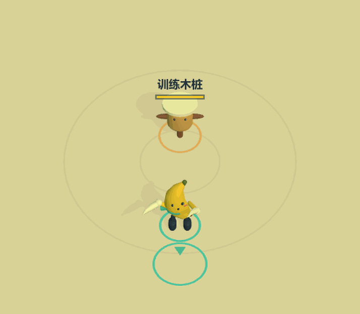
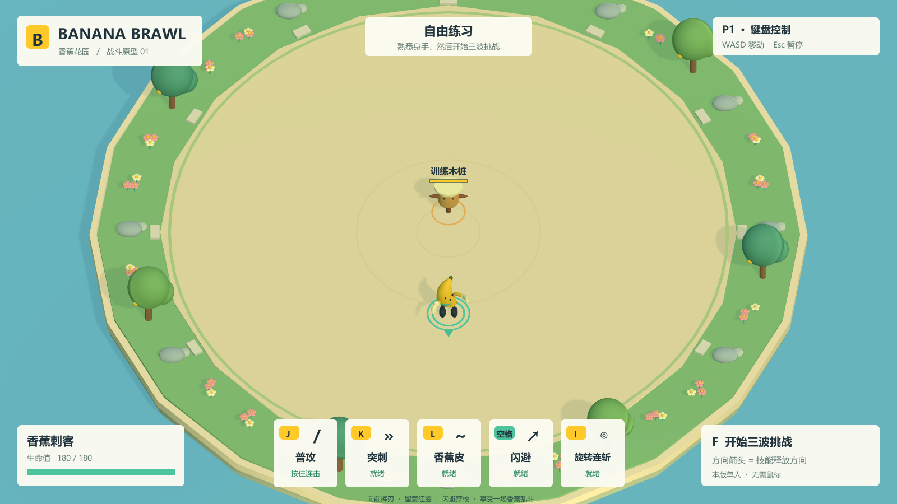

# BigBattle · 香蕉花园

面向 Windows 电视聚会场景的卡通 3D 俯视角战斗游戏。使用**团结引擎 1.9.3 / 2022.3.62t11**，首个角色是香蕉刺客。

当前版本为 **0.3.0 单人 MVP**：训练木桩、香蕉拼刀陪练、三波单人战斗、普攻和四个技能、暂停、胜负和重开。使用 13 个 Mixamo 动作适配；普攻为横斩 / 反手 / 月牙终结三段连招，支持长按和短按缓存。近乎同时相向出刀会拼刀，双方攻击免伤，伴随金属碰撞声与火花。新版有 60 个原创音效变体、多层刀光和收尾星芒。无需鼠标。后续目标是最多 **5 人同机分屏、合作与对战**；多人加入尚未实现。

Windows x64 构建成功（0 错误、0 警告），74 项独立程序自动检查和 53 项纯逻辑检查通过。真实 Xbox 手柄和电视操作体验仍待实机确认。详见 `Docs/VALIDATION.md`。



[新版音效试听](Docs/Audio/combat-audio-v030.wav)（七秒原创音效示例：三段连招、两次金属拼刀、突刺和连斩，非动图同步录音）。



## 启动

### 直接运行

本机构建完成后，启动 `Builds/Windows/BigBattle.exe`。完整 `Builds/Windows` 文件夹可以复制到其他 Windows 电脑；不能只复制 exe。生成的 Windows 文件不进入源码仓库。

本机另有便携压缩包 `Builds/BigBattle-v0.3.0-Windows.zip`，解压后运行 `BigBattle.exe`。GitHub 保存源码和预览图，运行包保留在本机。

### 在编辑器中

1. 用团结引擎打开仓库根目录。
2. 打开 `Assets/BigBattle/Scenes/BananaGarden.unity`，按 Play。
3. 如需重新生成场景，使用 `Tools > BigBattle > 1. Generate and open garden scene`。

本机编辑器路径：`E:\Unity\2022.3.62t11\Editor\Tuanjie.exe`。无外部插件或外部 Unity 包下载。完整动画需要本地 Mixamo 下载包，重建步骤见 [Docs/MIXAMO.md](Docs/MIXAMO.md)；原始素材与烘焙动作数据不公开分发。没有本地库时可以使用程序动画回退，但不能当作完整动画版本验收。

## 操作

| 动作 | 键盘 | Xbox |
| --- | --- | --- |
| 移动及朝向 | WASD | 左摇杆 |
| 普攻（可按住） | J | X |
| 突刺 | K | A |
| 香蕉皮陷阱 | L | B |
| 闪避（短暂无敌） | Space | LB |
| 旋转连斩 | I | Y |
| 开始三波挑战 / 返回练习 | F | View |
| 进入 / 重置拼刀陪练 | G | 十字键右 |
| 暂停 / 继续 | Esc | Menu |
| 菜单选择 | W/S 或上下键 | 方向键或左摇杆 |
| 菜单确认 / 战后再来一局 | Enter / J | A |

技能按角色朝向释放，停下时保留朝向。普攻、突刺、香蕉皮有小角度的前方辅助瞄准；不会自动攻击背后的敌人。闪避保持移动方向，不受辅助瞄准影响。旋转连斩攻击周围。

按住普攻可连续释放三段不同动作，也可连续点按，收招期间的短按会缓存 240ms。三段间隔为 0.30 / 0.34 / 0.52 秒，伤害 24 / 27 / 36，第三段伤害、击退和刀光更强。停手超过 1.05 秒回到起手。突刺沿经过的路径检测命中。刀光和命中事件与动作接触段对齐；命中后有 28–44ms 的轻微停顿，暂停菜单优先于命中停顿。

拼刀要求敌对双方相向、距离不超过 2.3 单位，刀刃接触时刻相差不超过 75ms。普通斩击与突刺参与判定，双方本次攻击一并消耗、都不造成伤害，同时播放一次清脆金属声、火花和“拼刀！”提示。旋转连斩、陷阱与无武器团子的攻击不参与拼刀；这不是额外的全身无敌。G / 十字键右可进入单人陪练：红围巾香蕉靠近并预警出刀，生命耗尽会恢复，可反复练习。返回木桩练习可用暂停菜单。

自由练习中的木桩不会永久死亡，累计伤害方便测试。挑战共三波、九只团子；红色圈是攻击预警。游戏失去焦点会自动暂停。

## 构建和验证

在 PowerShell 中运行：

```powershell
.\Tools\Build.ps1
.\Tools\Smoke.ps1
```

其他电脑可向 Build.ps1 的 `-Editor` 参数传入实际编辑器路径。编辑器菜单也可构建 Windows x64。

无许可证时，可先运行 `.\Tools\CheckSource.ps1` 检查 C# 编译和不依赖引擎运行时的输入 / 分屏逻辑。这不能代替编辑器导入、实际构建、画面和战斗验收。

- 构建输出：`Builds/Windows/`。
- 构建日志：`Artifacts/editor-build.log`、`Artifacts/build-result.txt`。
- 独立玩家自动验证：`Artifacts/Smoke/report.json` 和九张截图。
- 另有连招 / 拼刀接触截图、原创音效示例和 `--preview-capture` 动态录制入口。
- 源码仓库保留本次结果副本：`Docs/Validation/smoke-report.json`。
- 自动验证注入的是动作输入，不等同于真实 Xbox、双键盘或电视验收。实际硬件验证须另行记录。

## 结构与交接

后续音效 / 特效储备见 [团结商店素材清单](Docs/AssetLibrary/README.md)：已核对 10 个候选商品页（8 免费、2 付费），记录管线、最低引擎版本与用途。领取 / 下载尚待完成；本地接收目录为 `Artifacts/AssetStoreInbox/`，盘点命令 `Tools/InventoryAssetInbox.ps1`。当前游戏仍为已验证的 v0.3.0。

- `Assets/BigBattle/Runtime/Input`：键盘、Windows XInput、五人分屏矩形计算。
- `Runtime/Combat`：角色血量、阵营过滤、香蕉技能、统一近战 / 拼刀结算、香蕉陪练、团子 AI 和陷阱。
- `Runtime/Visuals`：原创香蕉关节模型、Mixamo 姿态插值 / 回退动画、场景、镜头、命中特效和分层合成音效。
- `Runtime/UI`：中文 HUD、全键盘 / 手柄菜单。
- `Runtime/Diagnostics`：仅通过 `--smoke-test` 启用的独立玩家验收。
- `Editor/ProjectBuilder.cs`：场景生成、项目配置和 Windows 构建。
- `Docs/DESIGN.md`：需求与架构约定；`update.md`：每次更新的验证记录与待办。

Windows 标准输入通常合并多把物理键盘。未来第五名玩家可采用第二套键位（预留方向键 + 数字小键盘），若两把键盘必须都使用 WASD，则需增加 Windows Raw Input 后端。当前没有实现五人加入或实际五人分屏。

每次完成更新必须更新 `update.md`，提交并同步至本仓库。`.meta` 必须保留；`Library`、`Temp`、`Builds`、`Artifacts` 等生成目录不提交。
