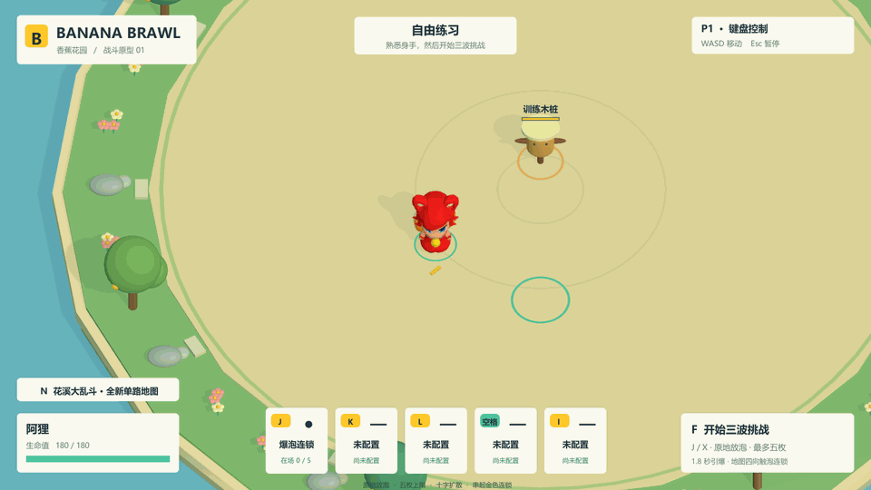
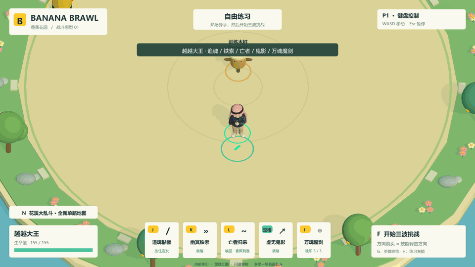
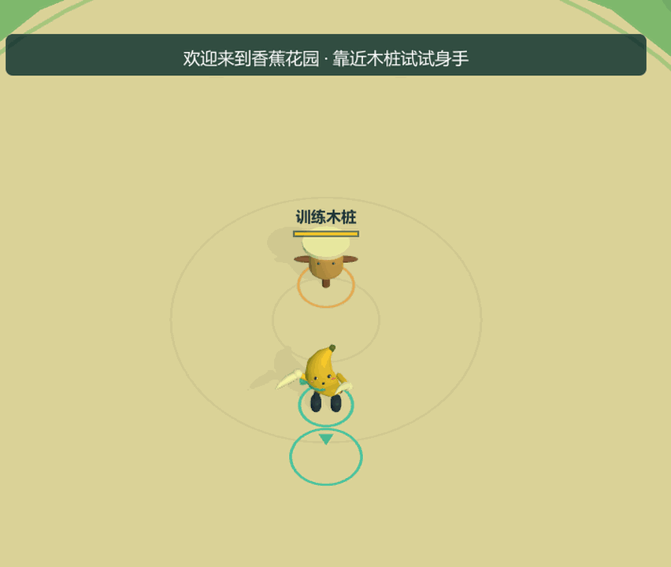
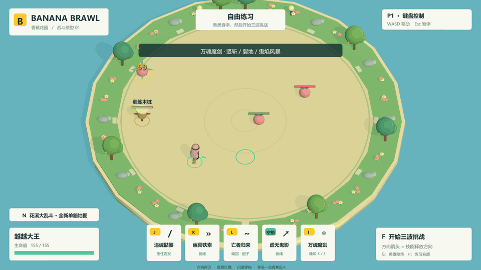
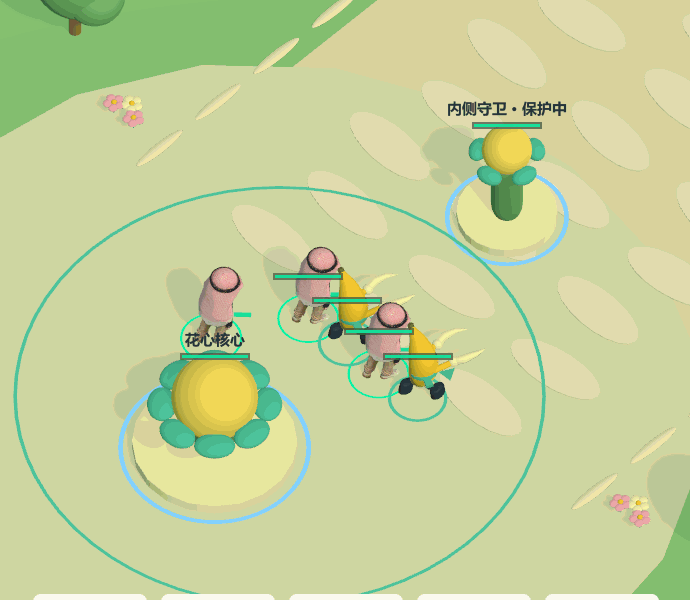
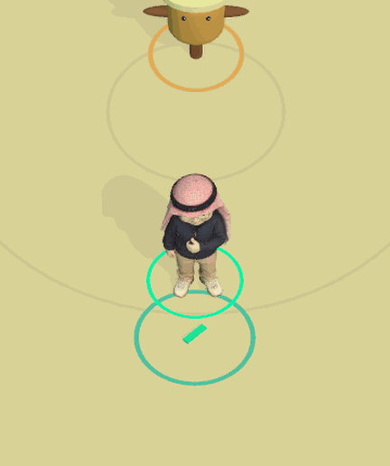
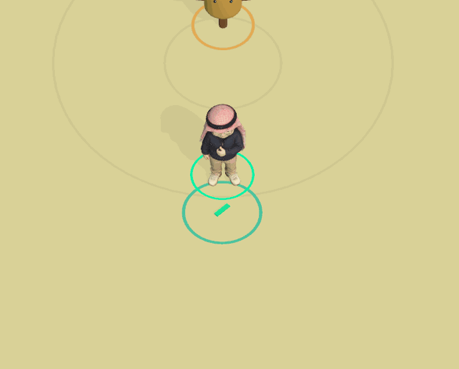

# BigBattle · 香蕉花园

面向 Windows 电视聚会场景的卡通 3D 俯视角战斗游戏。使用**团结引擎 1.9.3 / 2022.3.62t11**，可选择香蕉刺客、越越大王、阿狸，以及待设计技能的女巫预览。

当前版本为 **0.12.0 单人 MVP**：新增可战斗角色**阿狸**。J / Xbox X 在原地放下会呼吸的金色泡泡，**1.8 秒后十字爆炸、触泡连锁，最多五个待爆泡泡**。每臂长 5 / 宽 1.2 单位、0.15 秒展开，每泡对每个敌人最多 80 伤害，不伤自己和队友；花溪沿地图旋转轴展开。用户提供的 ali.fbx 补上 19 骨架、待机 / 行走 / 放置 / 倒下四个动作，支持练习、陪练、三波与花溪，以及越越大王的半属性召回。详见 [ALI.md](Docs/ALI.md)。

保留**女巫模型与基础动作预览**，使用用户提供的 xgx.fbx，原外观、17 骨架和 Idle / Walk / Greeting 三个 FBX 动作。选择女巫可移动、转身和暂停；普攻 / 技能等待用户设计，暂不进入战斗模式。详见 [WITCH.md](Docs/WITCH.md)。

保留官方 **Timeline 1.7.7**，用 10 份可编辑时间轴 / 44 个片段编排越越大王的聚魂、禁锢、召唤、鬼影、魔剑蓄力 / 释放，以及香蕉连招与拼刀。符文、双螺旋、魂晶、亮芯和冲击环按阶段出现，详见 [Timeline 特效与编辑](Docs/TIMELINE_VFX.md)。I 技能保持立体竖向巨刃与连续裂地。花溪大乱斗保留**左下角 → 右上角**路线，一名真人与四名 AI 对抗五名 AI，依次突破两座花朵守卫并摧毁敌方花心。浅蓝湖水、奶油色步道、圆树、花丛与荷叶延续明亮治愈风格。用三位战斗英雄进入练习后按 **N / 十字键上**开局，暂停菜单也可选择模式。详见 [花溪规则与交接](Docs/FLOWER_LANE.md)。

原香蕉刺客与越越大王保持可用。越越大王使用用户 FBX、自制骨骼和动作，拥有追踪骷髅、幽冥铁索、亡魂召唤、三秒虚无，以及三魂充能、四秒蓄力、500 伤害的贯穿魔剑。原训练木桩、英雄陪练与三波挑战仍可选择。

越越大王修正胸前左臂的骨骼和蒙皮，加入实际位移驱动的髋肩 / 摆臂 / 抬膝、起停转身、三套普攻手势、甩索、召唤、浮行，以及双手对齐的蓄力与下劈。实际从 **Kutejnikov、Cethiel、para 的 CC0 作品**获取并接入 7 张图集 / 212 源帧，在原 Kenney 素材基础上增加流焰光环、魂核漩涡、电弧爆发与帧动画火焰。原始许可、来源和每帧 / 图集校验随源码同步。详见 [动作与新特效](Docs/YUEYUE_MOTION.md)。

香蕉刺客保留“金月双刃”三段连招、突刺流光、旋转刃环和金白拼刀星爆，使用 13 个本地 Mixamo 动作。全局音效现为 68 个原创变体（含新爆泡声），相向武器在 75ms 窗口内拼刀取消双方本次伤害。无需鼠标。后续目标是最多 **5 人同机分屏、合作与对战**；多人加入尚未实现。

Windows x64 构建与独立玩家检查、三类主控的完整 AI 对局、真实画面记录见 [VALIDATION.md](Docs/VALIDATION.md)。真实 Xbox 手柄和电视操作体验仍待实机确认。角色规则 / 素材 / 交接见 [YUEYUE.md](Docs/YUEYUE.md)，香蕉特效见 [BANANA_VFX.md](Docs/BANANA_VFX.md)。5 对 5 指 AI 团队规模，当前仍只有一位真人输入。

















[新版音效试听](Docs/Audio/combat-audio-v030.wav)（七秒原创音效示例：三段连招、两次金属拼刀、突刺和连斩，非动图同步录音）。


## 启动

### 直接运行

本机构建完成后，启动 `Builds/Windows/BigBattle.exe`。完整 `Builds/Windows` 文件夹可以复制到其他 Windows 电脑；不能只复制 exe。生成的 Windows 文件不进入源码仓库。

本机另有便携压缩包 `Builds/BigBattle-v0.12.0-Windows.zip`，解压后运行 `BigBattle.exe`。GitHub 保存源码和预览图，运行包保留在本机。

### 在编辑器中

1. 用团结引擎打开仓库根目录。
2. 打开 `Assets/BigBattle/Scenes/BananaGarden.unity`，按 Play。
3. 进入角色选择，用 W/S 或方向键选择、Enter 确认。如需重新生成场景，使用 `Tools > BigBattle > 1. Generate and open garden scene`。

本机编辑器路径：`E:\Unity\2022.3.62t11\Editor\Tuanjie.exe`。工程解析官方 Timeline 1.7.7 包，继续使用 Built-in 渲染管线。完整动画需要本地 Mixamo 下载包，重建步骤见 [Docs/MIXAMO.md](Docs/MIXAMO.md)；原始素材与烘焙动作数据不公开分发。没有本地库时可以使用程序动画回退，但不能当作完整动画版本验收。

## 操作

| 香蕉刺客 / 越越大王 | 键盘 | Xbox |
| --- | --- | --- |
| 移动及朝向 | WASD | 左摇杆 |
| 三段普攻 / 追魂骷髅（可按住） | J | X |
| 突刺 / 幽冥铁索 | K | A |
| 香蕉皮陷阱 / 亡者归来 | L | B |
| 闪避 / 三秒虚无鬼影 | Space | LB |
| 旋转连斩 / 万魂魔剑（按住四秒再松开） | I | Y |
| 开始所选模式 / 返回练习 | F | View |
| 直接开始花溪大乱斗 | N | 十字键上 |
| 进入 / 重置英雄陪练 | G | 十字键右 |
| 越越大王练习充能（仅练习） | H | 十字键左 |
| 暂停 / 继续 | Esc | Menu |
| 菜单 / 英雄选择 | W/S 或上下键 | 方向键或左摇杆 |
| 菜单确认 / 战后再来一局 | Enter / J | A |

技能按角色朝向释放，停下时保留朝向。香蕉普攻、突刺、香蕉皮有小角度前方辅助瞄准；闪避保持移动方向，旋转连斩攻击周围。越越大王的骷髅只在发射时选择前方目标，随后有限度追踪；铁索与大招沿朝向直线飞行。

女巫当前只开放移动 / 转向、待机 / 行走 / 入场招呼；攻击键暂不释放动作或伤害。角色选择中确认第三张卡片即可预览，Esc / Menu 的切换角色可回到原两位英雄。

阿狸使用 **J / Xbox X** 放泡泡，按住可连续放置（间隔 0.22 秒），HUD 显示「在场 n / 5」。1.8 秒后十字爆炸可触发不同来源的泡泡连锁；每泡对每敌人一次 80 伤害，自己和队友免伤。其余四个动作暂未配置。地图没有实体墙或格子阻挡，爆炸在可走边界结束。

越越大王的 K 禁锢 2 秒、冷却 10 秒；L 召唤最近击败敌人的半生命 / 半攻击亡魂，存在 20 秒、冷却 25 秒；空格无敌且免控 3 秒、冷却 8 秒，期间可移动但不可进攻。本人 / 亡魂击杀真实敌人提供魂印，I 每次消耗三枚、冷却 20 秒。蓄力四秒时移速降低 90%，可被控制打断；蓄满后松开才发出每目标一次 500 伤害的贯穿剑气，配合强烈镜头震动与临时裂地。普通受伤不打断，提前松开 / 硬控 / 死亡取消不扣魂印。练习按 H / 十字键左充能。

按住普攻可连续释放三段不同动作，也可连续点按，收招期间的短按会缓存 240ms。三段间隔为 0.30 / 0.34 / 0.52 秒，伤害 24 / 27 / 36，第三段伤害、击退和刀光更强。停手超过 1.05 秒回到起手。突刺沿经过的路径检测命中。刀光和命中事件与动作接触段对齐；命中后有 28–44ms 的轻微停顿，暂停菜单优先于命中停顿。

拼刀要求敌对双方相向、距离不超过 2.3 单位，刀刃接触时刻相差不超过 75ms。普通斩击与突刺参与判定，双方本次攻击一并消耗、都不造成伤害，同时播放一次清脆金属声、火花和“拼刀！”提示。旋转连斩、陷阱与无武器团子的攻击不参与拼刀；这不是额外的全身无敌。G / 十字键右可进入单人陪练：红围巾香蕉靠近并预警出刀，生命耗尽会恢复，可反复练习。返回木桩练习可用暂停菜单。

自由练习中的木桩不会永久死亡，累计伤害方便测试。挑战共三波、九名敌人；越越大王路线后两波各含一名可击败的敌方英雄，方便召回英雄亡魂。红色圈是近战攻击预警。游戏失去焦点会自动暂停。

花溪大乱斗中，英雄阵亡后八秒复活，保留魂印 / 击败记录与正在进行的技能冷却；在己方基地回复生命。每十二秒双方各出发三名花灵，跟随它们可以移除建筑的 80% 无支援减伤，依次攻破外侧守卫、内侧守卫和花心。H 练习充能在比赛内无效。没有装备、经济或联网系统。

## 构建和验证

在 PowerShell 中运行：

```powershell
.\Tools\Build.ps1
.\Tools\Smoke.ps1
```

其他电脑可向 Build.ps1 的 `-Editor` 参数传入实际编辑器路径。编辑器菜单也可构建 Windows x64。

无许可证时，可先运行 `.\Tools\CheckSource.ps1` 检查 C# 编译和不依赖引擎运行时的输入 / 分屏逻辑。这不能代替编辑器导入、实际构建、画面和战斗验收。

- 构建输出：`Builds/Windows/`。
- 构建日志：`Artifacts/editor-build.log`、`Artifacts/build-result.txt`。
- 独立玩家自动验证：`Artifacts/Smoke/report.json` 和三十张编号截图。
- 完整 AI 对局：`Tools/LaneSimulation.ps1`；正常时钟实际画面录制：`Tools/PreviewLane.ps1`。加速模拟不等同于人工游玩或实时性能测量。
- 另有连招 / 拼刀接触截图、原创音效示例和 `--preview-capture` 动态录制入口。
- 源码仓库保留本次结果副本：`Docs/Validation/smoke-report.json`。
- 自动验证注入的是动作输入，不等同于真实 Xbox、双键盘或电视验收。实际硬件验证须另行记录。

## 结构与交接

后续音效 / 特效储备见 [素材清单](Docs/AssetLibrary/README.md)和[国际站获取记录](Docs/AssetLibrary/INTERNATIONAL.md)：共 14 个资源条目，已获取 Dustyroom 官网 CC0 音效包（50 个 WAV，见 `AssetLibrary/Audio/Dustyroom-CasualGameSounds/`）；其他条目仍待下载。记录管线、最低引擎版本、许可来源与 SHA-256。本地包接收目录为 `Artifacts/AssetStoreInbox/`，盘点命令 `Tools/InventoryAssetInbox.ps1`。v0.4.0 使用本项目原创网格和 Shader 制作攻击特效。

- `Assets/BigBattle/Runtime/Input`：键盘、Windows XInput、五人分屏矩形计算。
- `Runtime/Combat`：角色血量 / 控制、阵营过滤、两位英雄技能、亡魂归属与召唤 AI、扫掠投射物、统一近战 / 拼刀结算、英雄陪练、团子 AI 和陷阱。
- `Runtime/Modes`：花溪两队 AI、花灵兵线、守卫 / 花心、复活、模式与地图边界。
- `Runtime/Visuals`：原创香蕉关节模型、Mixamo 姿态插值 / 回退动画、场景、镜头、命中特效和分层合成音效。
- `Runtime/UI`：中文 HUD、全键盘 / 手柄菜单。
- `Runtime/Diagnostics`：仅通过 `--smoke-test` 启用的独立玩家验收。
- `Editor/ProjectBuilder.cs`：场景生成、项目配置和 Windows 构建。
- `Docs/DESIGN.md`：需求与架构约定；`update.md`：每次更新的验证记录与待办。

Windows 标准输入通常合并多把物理键盘。未来第五名玩家可采用第二套键位（预留方向键 + 数字小键盘），若两把键盘必须都使用 WASD，则需增加 Windows Raw Input 后端。当前没有实现五人加入或实际五人分屏。

每次完成更新必须更新 `update.md`，提交并同步至本仓库。`.meta` 必须保留；`Library`、`Temp`、`Builds`、`Artifacts` 等生成目录不提交。
